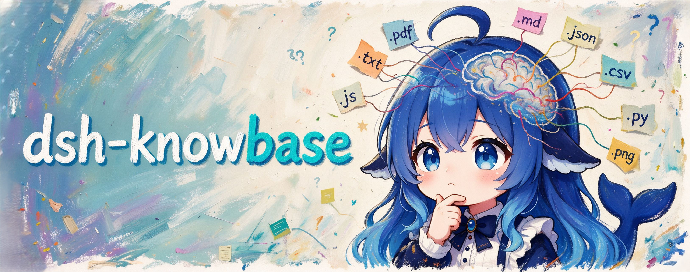

<div align="center">

# dsh-knowbase · Local Knowledge Base Plugin



[中文](./README.md) · English

[](https://www.npmjs.com/package/@domitor-syh/dsh-knowbase) [](./LICENSE) [](https://github.com/domitor-syh/dsh-knowbase/actions/workflows/ci.yml) [](https://github.com/domitor-syh/dsh-knowbase/actions/workflows/ci.yml) [](https://github.com/deepseek-ai/deepseek-harness/releases/tag/dsh-v0.2.1-rc.5)

</div>

A local knowledge base for [DeepSeek Harness](https://github.com/deepseek-ai/deepseek-harness) (DSH). Add your documents, retrieve relevant passages during conversations, and follow citations back to their sources.

## Features

- **Local document management**: Each knowledge base has its own folder. Upload files or add them through your file manager, then rescan to update the index incrementally.
- **Multiple document formats**: Supports UTF-8 text such as TXT, Markdown, JSON, CSV, and source code, text-based PDFs, and local Chinese and English OCR for PNG / JPG images.
- **Automatic retrieval**: Uses Chinese n-grams and BM25 to find relevant passages before each conversation step and provide source material for answers.
- **Per-session selection**: Choose one or more knowledge bases in the composer. Your selection is saved with the session.
- **Citations and document reading**: Inspect answer sources, copy citations, and open documents at the relevant location in the right sidebar.
- **Search testing and statistics**: Try queries on the knowledge base page and optionally enable automatic retrieval statistics in the plugin details.
- **New document proposals**: The Agent can propose text documents for you to preview and approve before saving them to a knowledge base.
- **Chinese and English UI**: Follows DSH's system language and light or dark theme.

## Installation

Currently aligned with **DSH 0.2.1-rc.5**, with a declared compatibility range of `>=0.2.0-rc.2 <0.3.0-0`.

**Web** (`dsh web`, install from npm):

```sh
dsh plugin --profile web add @domitor-syh/dsh-knowbase
```

**Desktop**: Enter this package name in the plugin manager's installation dialog:

```text
@domitor-syh/dsh-knowbase
```

After installation, restart `dsh web` and refresh the page, or restart the desktop app. When running DSH from source, prefix the Web installation command with `pnpm`.

## Usage

1. Open **Knowledge Base** in the sidebar, select **Add knowledge base**, and enter a name and description.
2. Upload documents, or open the knowledge base folder, add files, and select **Rescan**.
3. Return to the conversation, open **Knowledge Base** in the composer, and enable the bases you want to use for this session.
4. Ask a question. The plugin retrieves relevant passages from your selected bases for the model to reference.
5. Open the knowledge base sources below the answer to inspect citations, copy references, or read the original document in the right sidebar.

Knowledge bases start disabled in new sessions. Select the ones you need, and rescan after changing documents through your file manager.

### Image OCR

Download the Chinese and English language data from the image OCR section of the knowledge base page, then rescan your images. Once the language data is ready, text recognition runs locally.

### Search Testing

Enter a question in the search box on the knowledge base page and choose a search scope to see matching files, source locations, and passages. Expand the retrieval details to inspect scores and coverage.

### New Document Proposals

Ask the Agent to prepare content as a text document proposal, then preview, approve, or reject it in the conversation composer. Approved documents are saved to the selected knowledge base and become searchable.

### Common Commands

| Command | Purpose |
| --- | --- |
| `/kb help` | Show command help |
| `/kb list` | List knowledge bases and file counts |
| `/kb create <name>` | Create a knowledge base |
| `/kb files <base>` | List files in a knowledge base |
| `/kb use <base[,base]>` | Select knowledge bases for this session |
| `/kb use all` / `/kb use off` | Enable all bases or disable retrieval for this session |
| `/kb search <question>` | Test retrieval |
| `/kb rescan [--force] [base]` | Rescan documents; `--force` reparses every file |
| `/kb root` | Show the document root folder |

The retrieval algorithm is being continuously improved…

## License and Acknowledgments

This project is licensed under [MIT](./LICENSE).

Image OCR is powered by [Tesseract.js](https://github.com/naptha/tesseract.js). Thanks to the project and its contributors. Tesseract.js is licensed under [Apache-2.0](https://github.com/naptha/tesseract.js/blob/v7.0.0/LICENSE.md), and its license text is included in the distributed plugin package.
